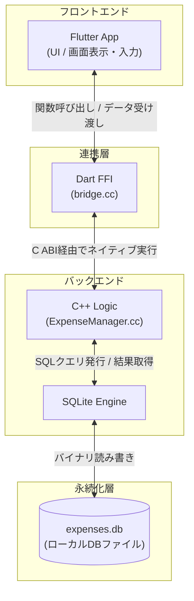

### 1. SQLiteってなに？（一言でいうと）
SQLiteは、一言で言うと**「ファイル1つで動く、超軽量で手軽なリレーショナルデータベース（RDB）」**です。

通常のデータベース（MySQLやPostgreSQL、Oracleなど）を使うときは、専用の「データベースサーバー」をパソコンやクラウド上に常に立ち上げておく必要があります。  
しかし、SQLiteには**専用のサーバーがありません**。データベース全体が、1つの「`.db`」のような普通のファイルとしてそのまま保存されます。

### 2. 何で話そうと思ったか
開発中の家計簿アプリの簡単な構成

支出/収入のデータを不揮発に保存するのによい方法だと思ったから

### 3. 最大の特徴とメリット
なぜ多くのアプリやシステムでSQLiteが選ばれているのか、主な理由は以下の4つです。

* **サーバー不要（Serverless）**
  * 常駐するサーバープログラムや面倒な初期設定（ポート番号の設定やユーザー権限管理など）が一切いりません。アプリから直接ファイルにアクセスして読み書きします。
* **ファイル1つで完結（Self-contained）**
  * データがすべて1つのファイルに収まるため、バックエンドの持ち運びや、他の環境へのコピーが驚くほど簡単です。
* **めちゃくちゃ軽い（Lightweight）**
  * ライブラリ自体が非常に小さく、メモリもほとんど食いません。
* **OSや環境を選ばない**
  * C言語で書かれており、Windows、macOS、Linuxはもちろん、スマホ（iOS/Android）、さらにはゲーム機や家電の組み込み機器まで、あらゆる場所で動きます。

### 4. 身の回りのどんなところで使われている？
「聞いたことないな？」と思うかもしれませんが、実は**世界で一番使われているデータベース**と言われています。

* **スマートフォン**：iPhoneやAndroidの中に標準で組み込まれており、アプリのデータ保存（連絡先、設定、アプリ内のデータなど）によく使われています。
* **ブラウザ**：Chrome、Firefox、SafariなどのWebブラウザが、履歴やブックマーク、クッキーの保存に使っています。
* **アプリケーション・ゲーム**：デスクトップアプリや、各種ゲームソフトのローカルデータ保存など。

### 5. 他のデータベース（MySQLなど）との違いは？
* **向いていること**
  * スマホアプリ、デスクトップアプリのローカル保存、小〜中規模のWebサイト、個人開発のサービス、テスト環境。
  * 「1つのアプリが自分の手元でデータを管理する」というシチュエーションには最強です。
* **向いていないこと**
  * 数千人〜数万人のユーザーが同時にガンガン書き込みを行うような大規模なWebサービス（アクセスが集中するとロックされて処理が追いつかなくなります）。
  * こういう場合は、クライアント・サーバー型のMySQLやPostgreSQLを使います。

### 6. ACIDの担保
#### 1. Atomicity（原子性 / A）
* **どういう意味？**：
  * 「複数の処理をまとめて1つのセットにする」特性です。途中でアプリが落ちたりエラーが起きた場合、**「すべて成功して保存されるか、さもなくば1件も変更されず最初の状態に戻る（全か無か）」**のどちらかしか起きないようにします。
* **どうやって担保している？**：
  * C++側で `BEGIN IMMEDIATE` から `COMMIT` までをトランザクションで囲むことで実現します。
  * 万が一途中でエラーが起きたら、C++のRAIIパターン（デストラクタ）によって自動で `ROLLBACK` が走り、中途半端なデータが残るのを完全に防ぎます。

#### 2. Consistency（一貫性 / C）
* **どういう意味？**：
  * 「ルール違反の変なデータが入り込まない」特性です。例えば「金額は必ず数値でマイナスは不可」「日付は必須」といったアプリのルール（制約）が常に守られます。
* **どうやって担保している？**：
  * テーブル作成時（`CREATE TABLE`）に設定した制約（`NOT NULL` や `PRIMARY KEY` など）によって強制されます。
  * もしルールに違反するデータを入れようとすると、トランザクション全体が失敗（エラー）になり、データベースが矛盾した状態になるのを防ぎます。

#### 3. Isolation（独立性・分離性 / I）
* **どういう意味？**：
  * 「同時に複数の操作（読み込みと書き込み）を行っても、お互いの邪魔をしない」特性です。画面を見ている最中に裏でデータを保存しても、データがごちゃ混ぜになりません。
* **どうやって担保している？**：
  * **WALモード（Write-Ahead Logging）**：読み込み専用の処理と、書き込み専用の処理の部屋を分けることで、お互いにブロックし合わずに並行処理を可能にします。
  * **ロック制御（`BEGIN IMMEDIATE` ＆ タイムアウト）**：書き込み同士のタイミングが被ったときは、デッドロックを防ぐために最初から予約ロックを取り、必要なら数秒間リトライ待ち（`sqlite3_busy_timeout`）をさせることで安全に順番をコントロールします。

#### 4. Durability（耐久性 / D）
* **どういう意味？**：
  * 「一度『保存した（コミットした）』データは、その後にアプリが強制終了したりスマホの電源がプツッと切れたりしても、絶対に消えずに残る」特性です。
* **どうやって担保している？**：
  * コミットが成功した時点で、変更内容が確実にストレージ（ディスクやフラッシュメモリ）のファイルに書き込まれます（SQLiteの同期メカニズム）。
  * WALモードの場合も、チェックポイントと呼ばれる仕組みで安全にメインのDBファイルにデータが反映されるため、電源断などのトラブルがあっても次回の起動時にデータが復旧・維持されます。
